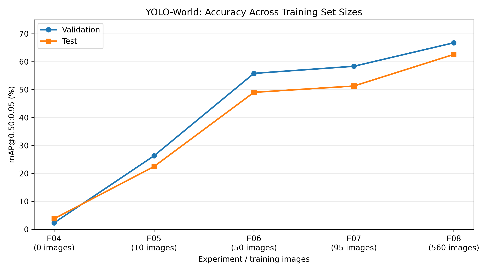
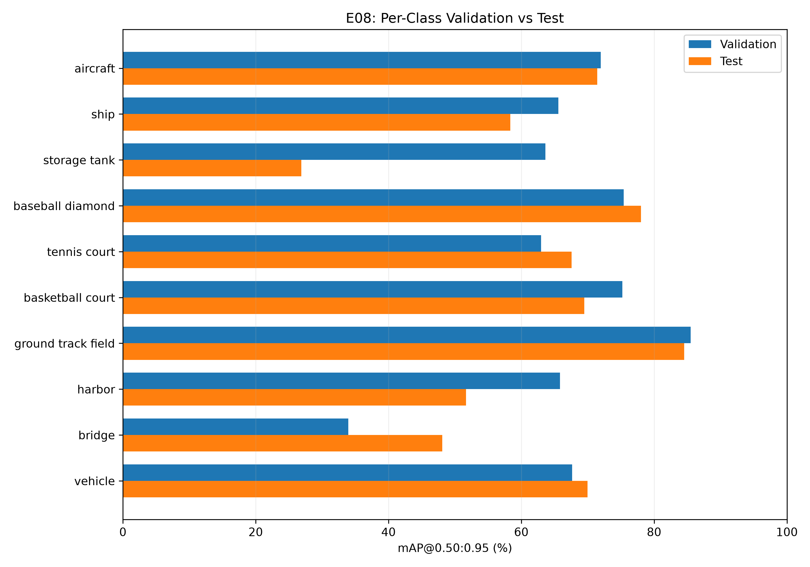
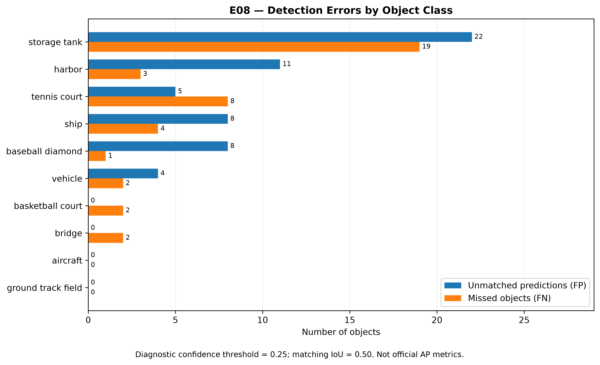

# Results and Discussion

## 1. Experimental Overview

This study evaluated YOLOv8s-WorldV2 on the NWPU VHR-10 remote-sensing dataset using zero-shot prompting and supervised fine-tuning.

The original dataset was divided into 560 training images, 120 validation images, and 120 held-out test images.

The fine-tuning experiments used 10, 50, 95, and 560 training images. These were image-based few-shot subsets rather than strict fixed numbers of object instances per class.

All fine-tuning experiments independently started from the original pretrained checkpoint. Training used 50 epochs, batch size 4, image size 640, AdamW, initial learning rate 0.0005, and random seed 42.

Models were selected using the validation set. Final testing used the same 120-image test set with 528 annotated objects for each model.

## 2. Overall Model Performance

| Experiment | Training images | Validation mAP50-95 | Test mAP50-95 | Test mAP50 |
|---|---:|---:|---:|---:|
| E04 — Zero-shot | 0 | 2.32% | 3.81% | 6.58% |
| E05 — One-shot | 10 | 26.31% | 22.47% | 37.24% |
| E06 — Five-shot | 50 | 55.81% | 49.03% | 77.44% |
| E07 — Ten-shot | 95 | 58.36% | 51.29% | 78.81% |
| E08 — Full training | 560 | 66.76% | 62.60% | 92.51% |

The full-data model, E08, achieved the highest overall test accuracy, with 62.60% mAP@0.50:0.95 and 92.51% mAP@0.50.

Compared with E04 zero-shot prompting, E08 improved test mAP@0.50:0.95 by +58.79 percentage points.

E08 also outperformed ten-shot E07 by +11.31 percentage points.

Performance increased as more annotated training images were introduced. The largest early improvement occurred when moving from one-shot to five-shot training.

*Figure 1. Validation and test accuracy across training dataset sizes.*

## 3. Validation and Test Generalization

| Experiment | Validation | Test | Test minus validation |
|---|---:|---:|---:|
| E04 | 2.32% | 3.81% | +1.49 pp |
| E05 | 26.31% | 22.47% | -3.84 pp |
| E06 | 55.81% | 49.03% | -6.78 pp |
| E07 | 58.36% | 51.29% | -7.07 pp |
| E08 | 66.76% | 62.60% | -4.16 pp |

The E08 model achieved 66.76% mAP@0.50:0.95 on validation and 62.60% on the held-out test set, a decrease of 4.16 percentage points.

This difference indicates that performance on the validation images was somewhat higher than performance on unseen test images.

## 4. Per-Class Performance

| Object class | Validation mAP50-95 | Test mAP50-95 | Difference (pp) |
|---|---:|---:|---:|
| aircraft | 71.95% | 71.44% | -0.51 |
| ship | 65.56% | 58.36% | -7.20 |
| storage tank | 63.61% | 26.86% | -36.75 |
| baseball diamond | 75.42% | 78.03% | +2.60 |
| tennis court | 62.99% | 67.59% | +4.60 |
| basketball court | 75.20% | 69.46% | -5.74 |
| ground track field | 85.49% | 84.55% | -0.94 |
| harbor | 65.81% | 51.67% | -14.13 |
| bridge | 33.96% | 48.08% | +14.12 |
| vehicle | 67.64% | 69.98% | +2.34 |

*Figure 2. E08 validation and test mAP@0.50:0.95 for the ten object categories.*

Storage tanks exhibited the largest negative generalization gap, declining from 63.61% on validation to 26.86% on test.

The validation partition contained only one image with storage-tank annotations, while the test partition contained three such images. This small number of distinct scenes limits the reliability of class-level comparisons.

## 5. Detection Error Analysis

A supplementary diagnostic analysis examined E08 predictions at confidence threshold 0.25 with class-aware matching at IoU 0.50.

The analysis found 487 matched predictions, 58 unmatched predictions, and 41 unmatched ground-truth objects.

| Class | GT | Matched | Unmatched predictions | Missed objects |
|---|---:|---:|---:|---:|
| aircraft | 97 | 97 | 0 | 0 |
| ship | 34 | 30 | 8 | 4 |
| storage tank | 94 | 75 | 22 | 19 |
| baseball diamond | 52 | 51 | 8 | 1 |
| tennis court | 96 | 88 | 5 | 8 |
| basketball court | 19 | 17 | 0 | 2 |
| ground track field | 29 | 29 | 0 | 0 |
| harbor | 45 | 42 | 11 | 3 |
| bridge | 13 | 11 | 0 | 2 |
| vehicle | 49 | 47 | 4 | 2 |

*Figure 3. Diagnostic unmatched predictions and missed objects by class.*

Storage tanks produced the most diagnostic errors. These counts should not be interpreted as the official precision, recall, or AP values, because the analysis used one fixed confidence threshold and IoU criterion.

## 6. Discussion

The experimental results show that supervised fine-tuning substantially improved YOLO-World performance on aerial imagery compared with zero-shot prompting.

The improvements from E05 to E06 were larger than those from E06 to E07. This suggests diminishing gains within the tested training protocol, although E08 achieved further improvement with the full dataset.

Performance varied substantially by object category. Storage tanks were notably less accurate on the test partition, while classes such as ground track fields and baseball diamonds achieved higher test accuracy.

The results indicate that domain-specific labeled data is important for adapting YOLO-World to remote-sensing imagery.

## 7. Limitations

First, the experiments used a single random seed and one dataset split. Performance variability across seeds was not measured.

Second, the fixed 50-epoch training schedule resulted in different numbers of optimizer updates as dataset size increased. Therefore, the results do not isolate dataset size from training computation.

Third, full-data E08 included 105 negative training images, whereas the few-shot subsets were selected from positive training images. This is an additional difference between the training conditions.

Fourth, class-level evaluation is sensitive to the number and diversity of available images. Some object categories were represented in only a few validation or test scenes.

Fifth, a cross-split perceptual-hash audit flagged two potentially similar train-test image pairs. No exact duplicates were found, but the candidates were not visually confirmed or dismissed. All original test images remained in the final evaluation.

Finally, the few-shot datasets were constructed by selecting images associated with each class while retaining all annotations in each selected image. Consequently, the one-, five-, and ten-shot terms refer to image selection rather than exactly one, five, or ten objects per class.

## 8. Conclusion

The full-data E08 model achieved 62.60% test mAP@0.50:0.95, compared with 3.81% for the selected zero-shot baseline.

The results demonstrate substantial benefits from supervised domain adaptation on NWPU VHR-10. However, generalization remains class-dependent, and further evaluation across independent datasets and training seeds is needed.

---

**Draft status:** Numerical results verified. Qualitative image review and references remain to be finalized.
